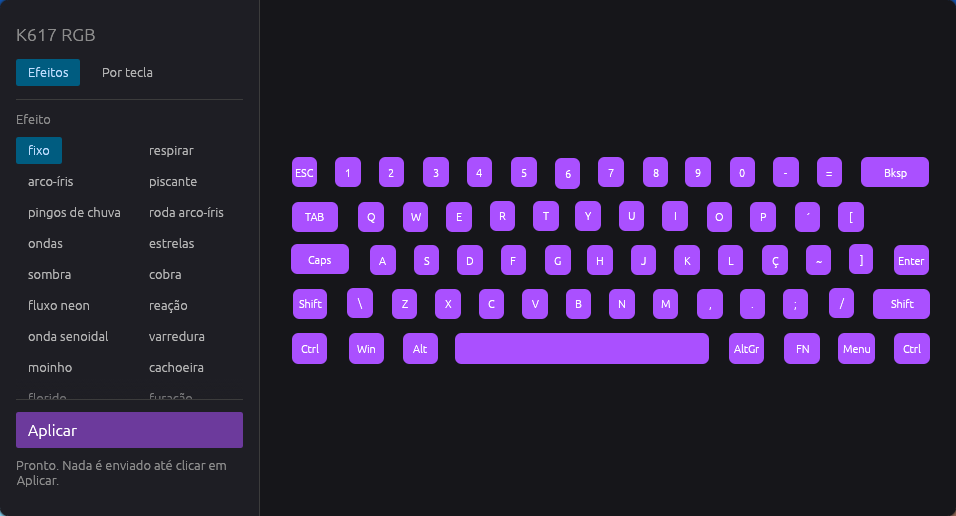
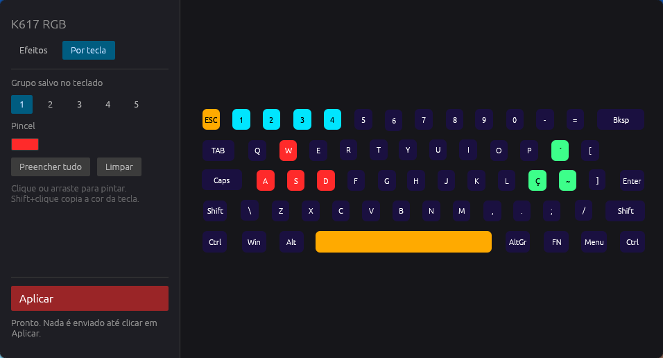

# redragon-fizz-k617-rgb

Controle open source do RGB do teclado **Redragon Fizz K617 (ABNT2)** no Linux, sem o software
oficial do Windows. Tem interface gráfica e linha de comando.

O firmware do teclado não é alterado: o programa só envia os mesmos comandos HID que o software
oficial envia. O protocolo foi obtido por engenharia reversa do `KeyboardDrv.exe` v1.6.6
(instalador oficial) e testado no teclado.

| Efeitos | Cor por tecla |
|---|---|
|  |  |

## Instalação

Requer Linux com hidraw e Rust (`cargo`).

```bash
git clone https://github.com/MarceloAntonio/redragon-fizz-k617-rgb.git
cd redragon-fizz-k617-rgb
cargo build --release --features gui
sudo cp target/release/k617rgb target/release/k617rgb-gui /usr/local/bin/
```

Só o CLI, sem nenhuma dependência: `cargo build --release`.

Para usar sem root, crie a regra udev e reconecte o teclado:

```bash
echo 'KERNEL=="hidraw*", ATTRS{idVendor}=="258a", ATTRS{idProduct}=="0049", TAG+="uaccess"' \
  | sudo tee /etc/udev/rules.d/70-k617.rules
sudo udevadm control --reload && sudo udevadm trigger
```

## Interface gráfica

```bash
k617rgb-gui
```

- **Efeitos**: escolha um dos 20 efeitos, a cor (ou "Aleatória"), a velocidade e o brilho.
- **Por tecla**: clique ou arraste sobre o teclado para pintar. Shift+clique copia a cor de uma tecla.
  São 5 grupos de cores, todos salvos no próprio teclado.
- Nada é enviado até clicar em **Aplicar**.
- As cores pintadas ficam salvas em `~/.local/share/k617rgb/`.

Por limitação do hardware, efeitos animados numa tecla só não existem: por tecla, a cor é sempre fixa.
A escolha da tecnologia (Rust + egui) está explicada em [docs/GUI.md](docs/GUI.md).

## Linha de comando

```
$ k617rgb -h
uso: k617rgb [--dry-run] <comando>

  dump                                   mostra os 136 bytes de config
  mode <1-20> [--color RRGGBB|random] [--speed 1-4] [--brightness 0-4]
  off                                    brilho 0 no modo atual
  keys <grupo 1-5> <RRGGBB> [tecla=RRGGBB ...]   cor por tecla (modo 21)

modos:
   1 fixo
   2 respirar
   3 arco-íris
   4 piscante
   5 pingos de chuva
   6 roda arco-íris
   7 ondas
   8 estrelas
   9 sombra
  10 cobra
  11 fluxo neon
  12 reação
  13 onda senoidal
  14 varredura
  15 moinho
  16 cachoeira
  17 florido
  18 furacão
  19 colisão
  20 perfeito
```

Exemplos:

```bash
k617rgb mode 1 --color ff8800 --brightness 4        # fixo, laranja, brilho máximo
k617rgb mode 2 --color random --speed 3             # respirar, cores aleatórias
k617rgb off                                         # apaga (brilho 0)
k617rgb keys 1 000000 w=ff0000 a=ff0000 s=ff0000 d=ff0000   # só WASD vermelho
k617rgb keys 2 1a1040 ç=00ff00                      # tudo roxo escuro, Ç verde
k617rgb dump                                        # mostra a config atual
k617rgb --dry-run mode 1 --color 00ff00             # só imprime os pacotes, sem enviar
```

Nomes de teclas aceitos no `keys`, com as legendas ABNT2:

| Linha | Teclas |
|---|---|
| 1 | `esc` `1`…`0` `-` `=` `backspace` |
| 2 | `tab` `q`…`p` `´` `[` |
| 3 | `capslock` `a`…`l` `ç` `~` `]` `enter` |
| 4 | `lshift` `\` `z`…`m` `,` `.` `;` `/` `rshift` |
| 5 | `lctrl` `lwin` `lalt` `space` `ralt` `fn` `app` `rctrl` |

## Observações

- Se o teclado se comportar de forma estranha, segure **Fn+Esc** por alguns segundos para
  restaurar o padrão de fábrica.

## Estrutura

- `src/lib.rs`: protocolo e acesso ao hidraw (usado pelo CLI e pela GUI)
- `src/main.rs`: CLI
- `src/bin/k617rgb-gui.rs`: interface gráfica (eframe/egui)
